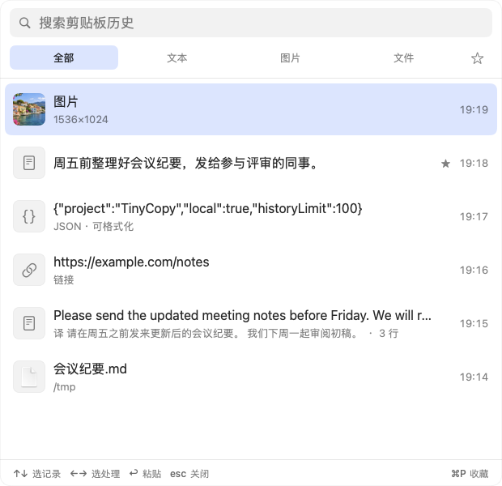
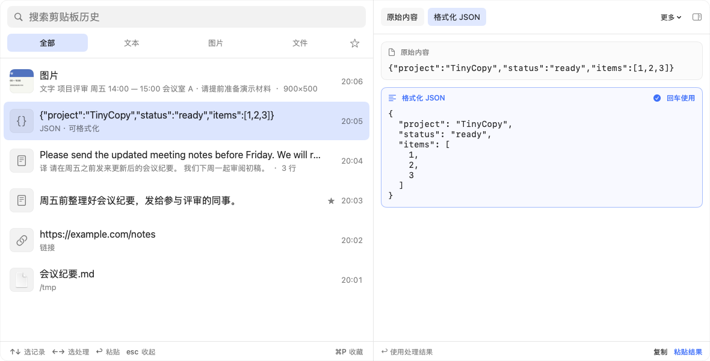
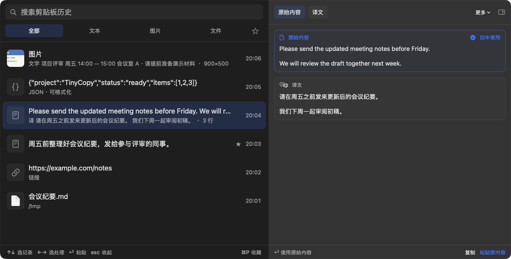
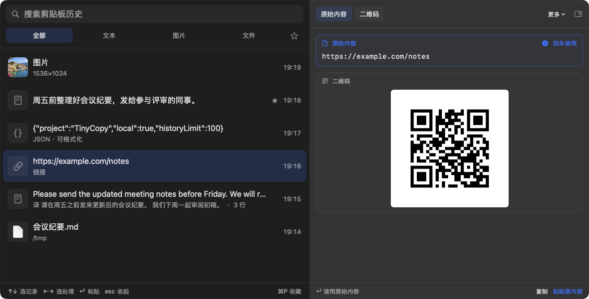

# TinyCopy

[简体中文](README.md) | **English**

TinyCopy is a macOS clipboard history tool for text, rich text, images and files. It supports search, favorites, translation, image text recognition and common text conversions.

Press `⇧⌘V` to open and type to search. Use Up/Down to choose a record, Left/Right to choose the original or a result, and Enter to paste.


## Features

| Feature | Description | Screenshot |
| --- | --- | --- |
| History, search and favorites | History survives restarts, and repeated copies move to the top. Filter by text, images or files. Search includes recognized text, translations and decoded content. Save and filter frequently used records as favorites. |  |
| Text conversions | Format or minify JSON, decode JWT, Base64 and URL-encoded text, and convert Unix timestamps. The original and result stay visible together; select one to copy or paste. |  |
| Translation | See the original and translation together using Apple translation. Requires macOS 15 or later; a language pack may need to be downloaded on first use. |  |
| Text recognition | Extract text from screenshots and other images for search, copying or pasting. Recognition runs on this Mac and keeps the original image. |  |
| QR codes | Extract QR content from images or generate a QR image from a URL. Detected links are not opened automatically. |  |

Choose light, dark or system appearance. Window size and position are remembered. Screenshots use sample content; the app interface is currently in Chinese.

## Download and use

Download the DMG from [Releases](https://github.com/YangHanqing/tinycopy/releases/latest), open it and drag TinyCopy into Applications. Requires macOS 14 or later, on Apple silicon or Intel. The app is signed and notarized by Apple.

The [introduction page](https://yanghanqing.github.io/tinycopy/) has feature examples and download links.

Click a record to preview it; double-click to paste the original. `⌘↩` copies only, `⌘P` toggles a favorite, and `Esc` collapses the preview or closes the window. You can change the opening shortcut in Settings.

Automatic pasting requires Accessibility permission. With permission, Enter pastes into your previous app. Without it, content is copied and you press `⌘V` yourself. If macOS asks about clipboard access, choose Always Allow so your history can be recorded.

## Privacy

History stays on this Mac. There is no account or telemetry. Clipboard content marked as concealed or transient, such as passwords from password managers, is ignored by default. Recognition and conversions use system frameworks; Apple translation language packs are downloaded by the system.

<details>
<summary>Build from source</summary>

Requires Xcode 27 and [XcodeGen](https://github.com/yonaskolb/XcodeGen).

```sh
xcodegen generate
open TinyCopy.xcodeproj
```

Run tests:

```sh
xcodebuild -project TinyCopy.xcodeproj -scheme TinyCopy -derivedDataPath build test
```

Use `scripts/install.sh` for a locally signed installation. See [site/README.md](site/README.md) for website updates and deployment.

</details>

## License

GNU General Public License version 3 ([GPL-3.0](LICENSE)).
