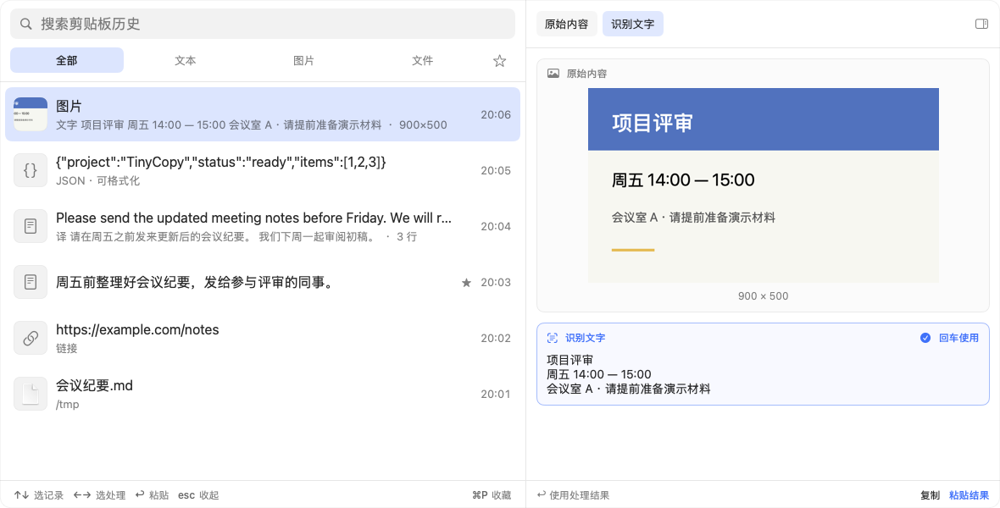
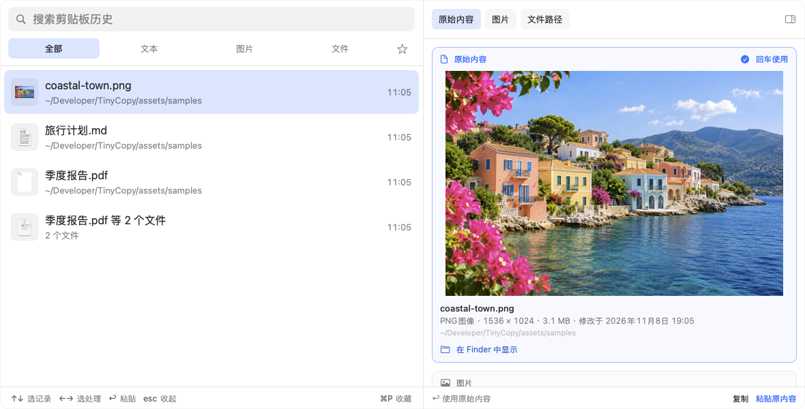
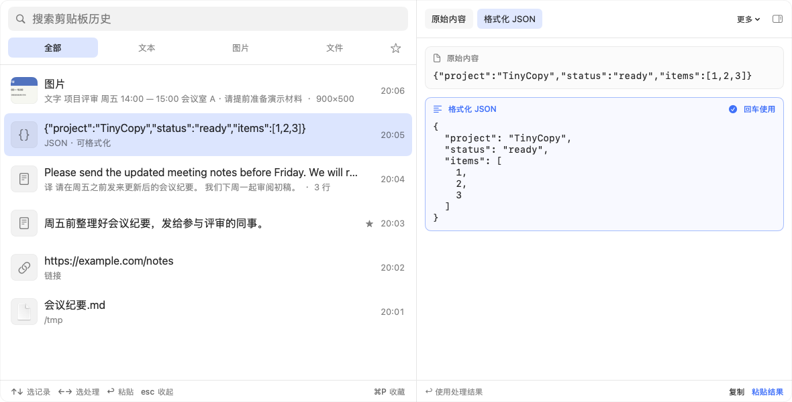
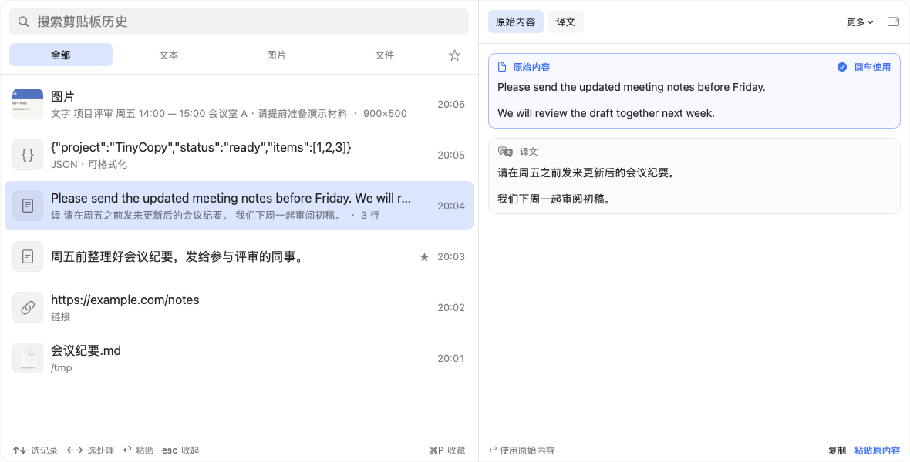

# TinyCopy 剪贴板历史

**简体中文** | [English](README.en.md)

TinyCopy 是一款 **macOS 原生剪贴板历史工具**，记录复制过的文字、富文本、图片和文件，按下快捷键即可找回，粘贴回原来的应用。

按 `⇧⌘V` 打开，输入关键词查找；上下键选记录，左右键选原始内容或处理结果，回车粘贴。JSON、编码文本、外语和截图里的文字，也能先处理再粘贴。

想快速了解 TinyCopy，可以先看 [介绍页](https://yanghanqing.github.io/tinycopy/)，主要功能都配有截图说明。

## 功能一览

以下截图使用示例内容，界面目前为中文。

| 功能 | 介绍 | 图片 |
| --- | --- | --- |
| 历史、搜索与收藏 | 文字、富文本、图片和文件都会记录，重启后依然保留；重复复制的内容移到顶部。可按文本、图片、文件筛选，搜索也覆盖识别出的文字、译文和解码结果。常用内容按 `⌘P` 收藏，不会被淘汰。 |  |
| 文件预览 | 复制的文件直接显示内容：图片、PDF、视频显示画面，文本和代码显示文字，文件被移动或删除时会标出。图片文件可以作为图片粘贴，文本文件可以直接粘贴其中的文字。 |  |
| JSON、解码与时间戳 | 格式化或压缩 JSON，保留键的顺序和数字原样；解码 JWT、Base64 和 URL 编码文本；把 Unix 时间戳转成日期。原始内容和结果同时显示，选中后才会使用处理结果。 |  |
| 系统翻译 | 使用 Apple 系统翻译，原文与译文一起显示，可选择复制或粘贴哪一份。需要 macOS 15 及以上，首次使用某种语言时可能需要下载语言包。 |  |
| 图片文字识别 | 从截图、会议通知等图片中提取文字，结果可以搜索、复制或粘贴。识别在本机完成，原图保留。 |  |
| 二维码 | 读出图片中的二维码，或把网址生成二维码图片。识别出的链接不会自动打开。 |  |
| 外观与窗口 | 支持浅色、深色和跟随系统，窗口位置与大小会被记住。菜单栏图标可以隐藏，也可以登录时自动启动。 |  |

## 使用

| 操作 | 按键 |
| --- | --- |
| 打开 / 关闭 | `⇧⌘V`（可在设置中修改） |
| 选记录 / 选内容 | `↑` `↓` / `←` `→` |
| 粘贴 | `↩`，或双击记录粘贴原始内容 |
| 只复制不粘贴 | `⌘↩` |
| 收藏 | `⌘P` |
| 收起预览或关闭 | `Esc` |

自动粘贴需要“辅助功能”权限。已授权时，回车直接粘贴到之前的应用；未授权时，内容只放回剪贴板，需自行按 `⌘V`。若系统询问剪贴板访问权限，请选择“始终允许”，以便记录历史。

如果别的应用（截图、剪贴板工具）也在使用 `⇧⌘V`，两边会同时响应，面板可能一闪而过；请在设置中换一个快捷键。

## 下载与安装

在 [Releases](https://github.com/YangHanqing/tinycopy/releases/latest) 页面（也可以从[介绍页](https://yanghanqing.github.io/tinycopy/#download)）下载最新版本，打开 DMG，将 TinyCopy 拖入“应用程序”文件夹。

- 支持 macOS 14 或更高版本，兼容 Apple 芯片和 Intel Mac。
- Apple 系统翻译需要 macOS 15。
- 应用使用 Developer ID 签名并经过 Apple 公证，可直接打开。

## 隐私与联网

TinyCopy 不收集用户数据。历史只保存在这台 Mac 上，不需要账户，也没有云同步。默认忽略密码管理器等应用标记为保密或临时的内容。图片文字识别、二维码和文本转换均在本机完成；Apple 系统翻译在本机运行，语言包由系统下载。

TinyCopy 只在检查更新时联网：每 30 天向 GitHub 查询一次最新版本号，不发送任何标识信息；有新版本时在面板底部和菜单中提示，只打开发布页面，不会自动下载或安装。可在 设置 ▸ 通用 中关闭。

## 从源码构建

安装 Xcode 27 或更高版本及 [XcodeGen](https://github.com/yonaskolb/XcodeGen)，在仓库根目录运行 `xcodegen generate`，然后打开 `TinyCopy.xcodeproj`，选择 **TinyCopy** scheme 运行。

## 许可证

GNU 通用公共许可证第 3 版（GPL v3）。
