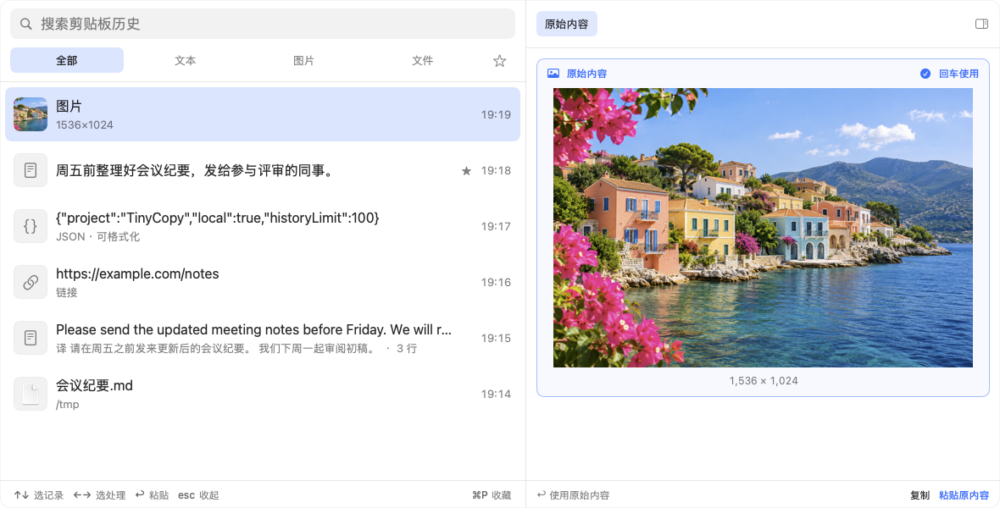
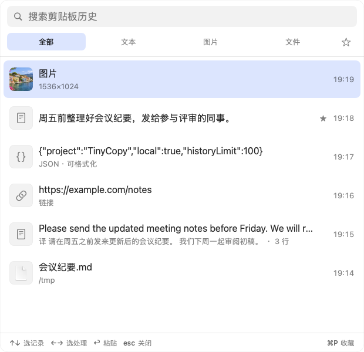
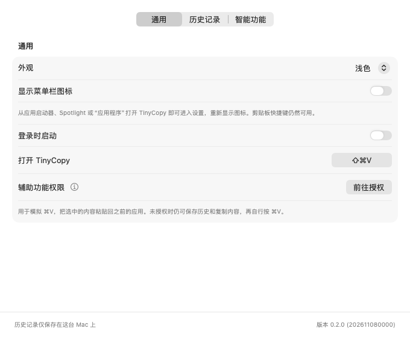
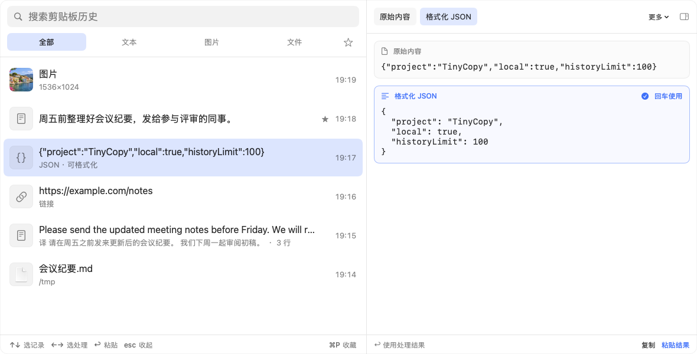
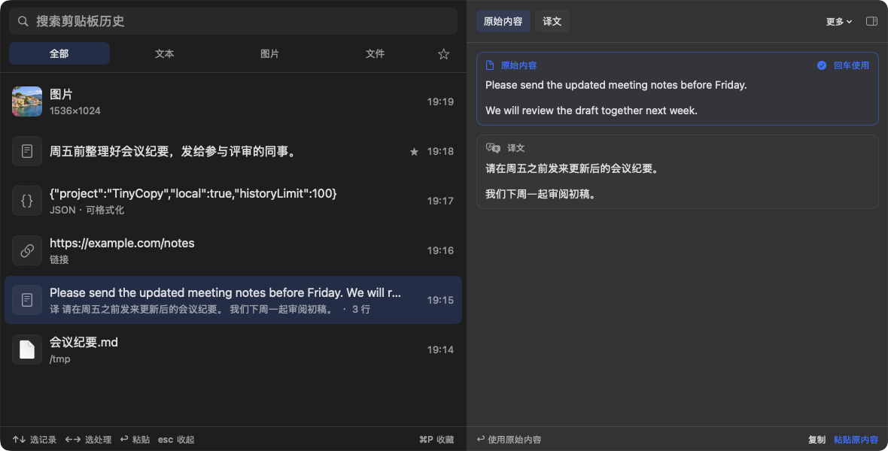
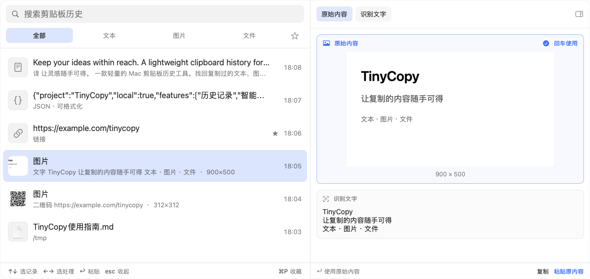
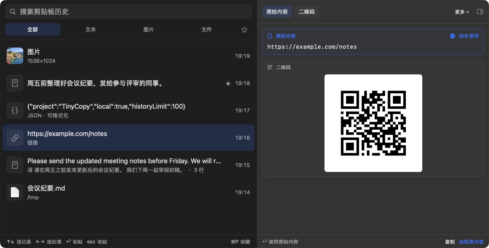

# TinyCopy

TinyCopy 是一个 macOS 原生剪贴板历史工具，保存复制过的文字、富文本、图片和文件。

按 `⇧⌘V` 打开，输入关键词查找记录。上下键切换记录，左右键选择原始内容或处理结果，回车粘贴到之前使用的应用。

支持 macOS 14 及以上，兼容 Apple 芯片和 Intel Mac。数据保存在本机，不需要账户。



## 功能一览

截图使用示例内容，包含浅色和深色两种外观。[介绍页](https://yanghanqing.github.io/tinycopy/)也提供功能截图和下载入口。

### 历史记录与界面

| 功能 | 介绍 | 图片 |
| --- | --- | --- |
| 记录与恢复 | 保存文字、富文本、图片和文件引用，重启后保留。重复复制的内容移到顶部，历史条数上限可在设置中修改。 |  |
| 搜索与分类 | 支持多个关键词，按全部、文本、图片、文件筛选。图片中的文字、二维码内容、译文及解码结果也可搜索。 | |
| 收藏 | 按 `⌘P` 收藏或取消收藏。收藏记录不受普通历史条数限制；分类行右侧星标可只看收藏，与分类、搜索同时使用。 | |
| 内容预览 | 打开时只显示列表，浏览记录后展开预览。原始内容和处理结果同时显示，每次换记录都默认选中原始内容。 | |
| 窗口与外观 | 支持拖动、缩放并记住位置；外观可选浅色、深色或跟随系统。菜单栏提供重置窗口、清空历史入口。 | |
| 隐藏菜单栏图标 | 在设置中关闭图标后，可从应用启动器、Spotlight 或“应用程序”打开 TinyCopy 进入设置，重新显示图标。历史快捷键仍可用。 |  |

### 内容处理

| 功能 | 介绍 | 图片 |
| --- | --- | --- |
| JSON | 格式化、压缩，保留键的顺序和数字写法。 |  |
| 解码与时间转换 | 识别 JWT、Base64、URL 编码文本和 Unix 时间戳。JWT 可查看 Header、Payload 和过期时间，但不验证签名；时间戳可转换为本地时间或 ISO 8601。 | |
| 翻译 | 原文和译文同时显示，可选择复制或粘贴。支持自动后台翻译、按需翻译和关闭，可设置目标语言。使用 Apple 系统翻译，需要 macOS 15 及以上；语言包需由系统下载。 |  |
| 图片文字识别 | 查看完整图片，提取文字用于搜索、复制或粘贴。识别在本机完成，原始图片保留；可选择自动、按需识别或关闭。 |  |
| 二维码 | 从图片中提取二维码内容，不会自动打开其中的链接；网址可生成正方形二维码，复制或粘贴为图片。使用 macOS 自带框架，无需第三方库。 |  |
| 其他工具 | 纯文本粘贴、去除首尾空白、复制文件路径。Base64 编码、URL 编码、压缩 JSON 等低频操作放在右上角“更多”中，不参与左右键切换。 | |

## 快捷键与鼠标

| 按键 | 作用 |
| --- | --- |
| `⇧⌘V` | 打开或关闭历史窗口，可在设置中修改 |
| `↑` `↓` | 切换记录、展开预览，并选中原始内容 |
| `←` `→` | 选择原始内容或处理结果 |
| `⇥` / `⇧⇥` | 选择下一份或上一份内容，搜索时也可用 |
| `↩` / `⌘↩` | 粘贴 / 只复制 |
| `⌘P` | 收藏或取消收藏 |
| `⌘⌫` | 删除记录 |
| `Esc` | 先收起预览，再按一次关闭窗口 |
| `⌘,` | 打开设置 |

鼠标单击记录可预览，双击粘贴原始内容；右键可复制、粘贴转换结果、收藏或删除。搜索文字编辑时，左右键仍用于移动光标，按上下键浏览记录后才切换处理结果。

若快捷键与其他剪贴板或截图工具冲突，可在设置中更换。

## 权限与本地数据

| 项目 | 说明 |
| --- | --- |
| 辅助功能权限 | 用于模拟 `⌘V`。已授权时，回车直接粘贴到之前的应用；未授权时，内容只放回剪贴板，需自行按 `⌘V`。保存历史、搜索和复制本身不需要此权限。 |
| 剪贴板访问 | 较新的 macOS 可能询问是否允许读取剪贴板。请选择“始终允许”，否则部分内容可能未被记录；应用会在菜单栏和设置中提醒。 |
| 本地存储 | 历史记录仅保存在这台 Mac 上，没有账户，不收集遥测数据。默认不记录密码管理器等应用标记为保密或临时的内容。 |
| 语言包 | 文字识别、二维码和转换使用系统框架；Apple 翻译首次使用某种语言时，可能需要下载语言包。 |

辅助功能授权位置：系统设置 ▸ 隐私与安全性 ▸ 辅助功能。

## 下载与安装

在 [Releases](https://github.com/YangHanqing/tinycopy/releases/latest) 下载 DMG，打开后将 TinyCopy 拖入“应用程序”文件夹。应用使用 Developer ID 签名并经过 Apple 公证。

## 从源码构建

安装 Xcode 27 和 [XcodeGen](https://github.com/yonaskolb/XcodeGen)，在仓库目录运行：

```sh
xcodegen generate
open TinyCopy.xcodeproj
```

<details>
<summary>测试、本机安装与介绍页</summary>

```sh
xcodebuild -project TinyCopy.xcodeproj -scheme TinyCopy -derivedDataPath build test
scripts/install.sh
```

安装脚本使用本机 Apple Development 证书签名，安装到 `/Applications` 并启动。Debug 版使用独立的 Bundle ID 和数据目录；ad-hoc 签名重建后可能使辅助功能授权失效，验证自动粘贴时建议使用稳定签名版本。

正式版数据保存在 `~/Library/Application Support/cn.hqyang.TinyCopy/`。

介绍页位于 `site/`，不需要前端依赖。更新页面资源和本地预览：

```sh
python3 scripts/build_site.py
python3 -m http.server 8080 --directory site
```

部署步骤见 [site/README.md](site/README.md)。截图和页面资源不会包含在应用安装包中。

</details>

## 许可证

GNU 通用公共许可证第 3 版（[GPL-3.0](LICENSE)）。
