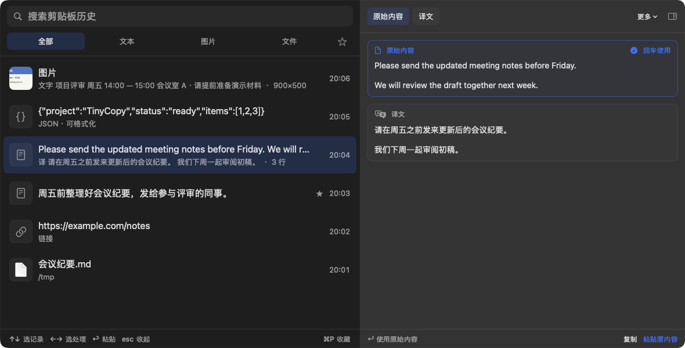

# TinyCopy

**简体中文** | [English](README.en.md)

TinyCopy 是一个 macOS 剪贴板历史工具，记录复制过的文字、富文本、图片和文件。支持搜索、收藏、翻译、图片文字识别和常用文本转换。

按 `⇧⌘V` 打开，输入关键词查找。上下键选记录，左右键选原始内容或处理结果，回车粘贴。


## 功能

| 功能 | 说明 | 截图 |
| --- | --- | --- |
| 历史、搜索与收藏 | 重复复制的内容移到顶部，历史在重启后保留。可按文本、图片、文件分类，搜索也包括识别文字、译文和解码结果。常用内容可收藏、单独筛选。 |  |
| 文本转换 | JSON 格式化与压缩，JWT、Base64、URL 解码，Unix 时间戳转换。原始内容和结果同时显示，选中后可复制或粘贴。 |  |
| 翻译 | 使用 Apple 系统翻译，原文与译文一起显示。需要 macOS 15 及以上，首次使用某种语言时可能需下载语言包。 |  |
| 图片文字识别 | 从截图等图片中提取文字，结果可搜索、复制或粘贴。识别在本机完成，原图保留。 |  |
| 二维码 | 提取图片中的二维码内容，或把网址生成二维码图片。识别出的链接不会自动打开。 |  |

支持浅色、深色和跟随系统，窗口位置与大小会被保留。截图使用示例内容，界面目前为中文。

## 下载与使用

在 [Releases](https://github.com/YangHanqing/tinycopy/releases/latest) 下载 DMG，打开后将 TinyCopy 拖入“应用程序”。支持 macOS 14 及以上、Apple 芯片和 Intel Mac，应用已签名并通过 Apple 公证。

[介绍页](https://yanghanqing.github.io/tinycopy/)提供功能示例和下载入口。

鼠标单击预览，双击粘贴原始内容。`⌘↩` 只复制，`⌘P` 收藏，`Esc` 收起预览或关闭窗口；打开快捷键可在设置中修改。

自动粘贴需要辅助功能权限。已授权时，回车直接粘贴到之前的应用；未授权时，内容只放回剪贴板，需自行按 `⌘V`。若系统询问剪贴板访问权限，请选择“始终允许”，以便记录历史。

## 隐私

历史只保存在这台 Mac 上，不需要账户，不收集遥测数据。默认忽略密码管理器等应用标记为保密或临时的内容。识别和转换使用系统框架，Apple 翻译语言包由系统下载。

<details>
<summary>从源码构建</summary>

需要 Xcode 27 和 [XcodeGen](https://github.com/yonaskolb/XcodeGen)。

```sh
xcodegen generate
open TinyCopy.xcodeproj
```

运行测试：

```sh
xcodebuild -project TinyCopy.xcodeproj -scheme TinyCopy -derivedDataPath build test
```

本机签名安装使用 `scripts/install.sh`。介绍页更新与部署见 [site/README.md](site/README.md)。

</details>

## 许可证

GNU 通用公共许可证第 3 版（[GPL-3.0](LICENSE)）。
